<div align="center">
  
</div>

<h3 align="center">Desarrollador en formación · Laravel + Docker · Aprendiendo Next.js</h3>

<p align="center">
  Construyo aplicaciones web con <b>Laravel</b>, <b>Blade</b> y <b>Docker</b>.<br/>
  Ahora estoy metido de lleno en <b>Next.js</b>.
</p>

---

## Sobre mí

```php
$chava = [
    'ubicación'  => 'Cartago, Costa Rica',
    'enfoque'    => 'Desarrollo web full-stack',
    'stack'      => ['PHP', 'Laravel', 'Blade', 'MySQL', 'Docker'],
    'aprendiendo' => 'Next.js',
    'proyecto'   => 'Sistema de calificación de proyectos para ExpoTEC 2026',
];
```

Me gusta entender cómo funciona todo por dentro: desde una consulta SQL hasta el contenedor
que levanta la app. Aprendo construyendo, rompiendo y volviendo a levantar.

---

## Stack

<p align="left">
  
  
  
  
  
  
  
  
</p>

---

## Estadísticas

<p align="center">
  
  
</p>

<p align="center">
  
</p>

---

## Ahora aprendiendo

| | Tema | Estado |
| :-- | :-- | :-- |
| 🚀 | **Next.js** — App Router, Server Components, despliegue | `en curso` |
| 🧩 | **TypeScript** aplicado a Next.js | `siguiente` |
| 🐳 | **Docker + CI/CD** para desplegar con confianza | `después` |

---

## Contacto

<p align="center">
  <a href="mailto:jkart2731@gmail.com">
    
  </a>
  <a href="https://github.com/chava2707">
    
  </a>
</p>

<p align="center">
  <sub>Cartago, Costa Rica · Siempre aprendiendo algo nuevo</sub>
</p>
